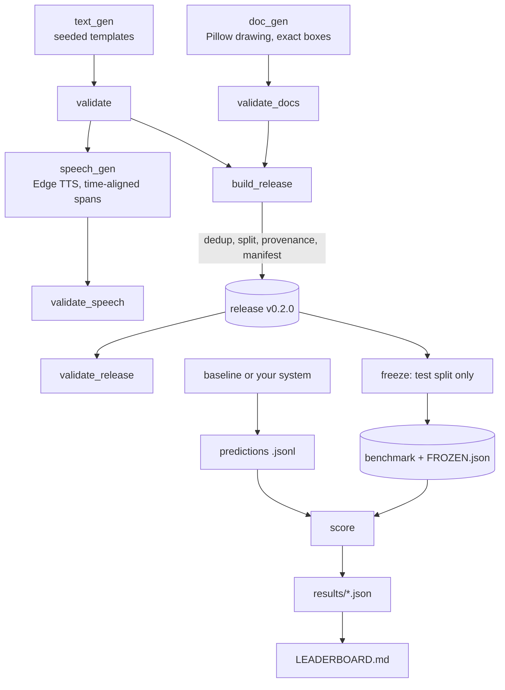

# Pipeline

How the toolkit turns seeds into a validated, documented release and a frozen benchmark.
Everything runs with `make all`; the individual commands are listed below.

## Stages

| Stage | Command | Reads | Writes | Checks |
| --- | --- | --- | --- | --- |
| Generate text | `python -m piikit.text_gen --n 1000 --seed 42 --out data/raw/text.jsonl` (supports `--locale`, `--hard`) | seed | `text.jsonl` | none (see next row) |
| Validate text | `python -m piikit.validate data/raw/text.jsonl` | `text.jsonl` | report | schema, `text[start:end]` equals the span text, offsets in range, no overlaps, labels allowed, unique ids |
| Generate documents | `python -m piikit.doc_gen --n 200 --seed 42 --out-dir data/raw/docs` (supports `--noisy`, `--font`) | seed | PNG images, `docs.jsonl` | none (see next row) |
| Validate documents | `python -m piikit.validate_docs data/raw/docs/docs.jsonl` | images, `docs.jsonl` | report | image exists and matches stated size, boxes inside the image, boxes contain visible text, no overlapping boxes |
| Generate speech | `python -m piikit.speech_gen --text data/raw/text.jsonl --n 50 --seed 42 --out-dir data/raw/speech` (supports `--locale`) | `text.jsonl`, Edge TTS | `audio/*.mp3`, `speech.jsonl` | none (see next row) |
| Validate speech | `python -m piikit.validate_speech data/raw/speech/speech.jsonl` | audio files, `speech.jsonl` | report | required keys, audio file exists, span text-slice matches, time offsets within duration, unique ids |
| Build release | `python -m piikit.build_release ...` | both datasets | `data/release/v0.2.0/` | see below |
| Validate release | `python -m piikit.validate_release data/release/v0.2.0` | the release | report | manifest checksums and counts, schemas per split, provenance on every record, no id, text or image shared between splits |
| Freeze benchmark | `python -m piikit.freeze build --release ... --out benchmark` | release test split | `benchmark/` | refuses to overwrite an existing frozen benchmark |
| Run a baseline | `python -m piikit.baselines text-regex --bench benchmark --out preds.jsonl` (also `text-ner`, `docs-ocr`) | `benchmark/` | predictions | refuses to run if frozen files changed |
| Score | `python -m piikit.score text --pred preds.jsonl --name my-system --save` | predictions, `benchmark/` | `results/*.json` | frozen check, every id present, valid offsets and labels |
| Markdown Leaderboard | `python -m piikit.leaderboard --bench benchmark` | `results/*.json` | `LEADERBOARD.md` | ignores results scored against a different frozen id |
| HTML Leaderboard | `python -m piikit.leaderboard_html --bench benchmark --out docs/leaderboard.html` | `results/*.json` | `docs/leaderboard.html` | self-contained interactive web dashboard |
| Submit CLI | `python -m piikit.submit --task text --pred preds.jsonl --name "My System" --html` | predictions | benchmark & leaderboards | scores, updates markdown and HTML leaderboards in one step |
| Publish to Hub | `python -m piikit.push_hub --release data/release/v0.2.0 --repo user/dataset --with-images` | release directory | Hugging Face Hub | pushes DatasetDict subsets (`text`, `docs`), card, and document images |

`build_release` does four things in order: deduplicate (exact and near-duplicates), assign
splits from a hash of each record id, attach a provenance block to every record, and write
`MANIFEST.json`, `PROVENANCE.json`, `dedup_report.json` and `DATASET_CARD.md`.

## Design decisions

- **Every record has its own random generator**, seeded from the global seed and the record
  index. Record 10 is identical whether you generate 20 records or 2,000, and the same seed
  gives a byte-identical file. Tests check both.
- **Deduplicate before splitting.** A duplicate that survives into two splits would leak
  test data into training. Splits come from a hash of the id, so a record never changes
  split when other records are added or removed.
- **Provenance travels with each record**, not only with the release: generator, input file
  and line, input checksum, a synthetic flag and the licence.
- **The benchmark is frozen by checksum.** Inputs given to a system contain only an id and
  the text (or image details), never labels or generator details. Scoring refuses to run
  against modified files.
- **Strict and relaxed text scoring.** Strict needs the exact span; relaxed accepts the same
  label with at least half the characters overlapping. The gap between them shows whether a
  system finds entities but gets boundaries wrong.
- **Bootstrap intervals** over test records make small-sample uncertainty visible. The test
  split is small, so the intervals are wide.
- **Validators are separate from generators.** The generators are trusted by construction,
  and the validators check the files as written, so they also catch edited or corrupted data.
- **Standard library first.** Runtime dependencies are kept minimal: Pillow for drawing
  documents, edge-tts for speech synthesis, and pytesseract for the OCR document baseline.
  The core text pipeline (generate → validate → release → score) has no extra dependencies.

## Reproducibility

- Same seed, same inputs and same parameters give byte-identical annotation and release files.
- Document PNG bytes can vary between Pillow versions, which changes the benchmark's
  `frozen_id` and the manifest checksums for images. Annotations and text metrics do not change.
- The benchmark is committed to the repository, and CI verifies its checksums on every push.
  Regenerating it on another machine is a deliberate act (`make refreeze`) and discards
  existing results.

## Extending

- **Score your own system:** write a predictions file in the format described in the README,
  then run `piikit.score ... --save` and `piikit.leaderboard`.
- **Add a label:** add it to `piikit/schema.py`, give it a generator in `piikit/text_gen.py`,
  map it in `piikit/label_map.py`, and add tests. The validators and scorer pick it up from the schema.
- **Add a document type:** add a drawing function and its page size in `piikit/doc_gen.py`
  and the type name in `piikit/schema.py`.
- **Extend the speech pilot:** increase `--n` for a larger audio set, or swap Edge TTS for a
  local TTS engine by replacing `_synthesize` in `piikit/speech_gen.py`. The alignment logic is
  engine-agnostic as long as sentence-level timestamps are provided.

See the [dataset card](DATASET_CARD.md) for contents and limitations, and the
[leaderboard](../benchmark/LEADERBOARD.md) for current results.