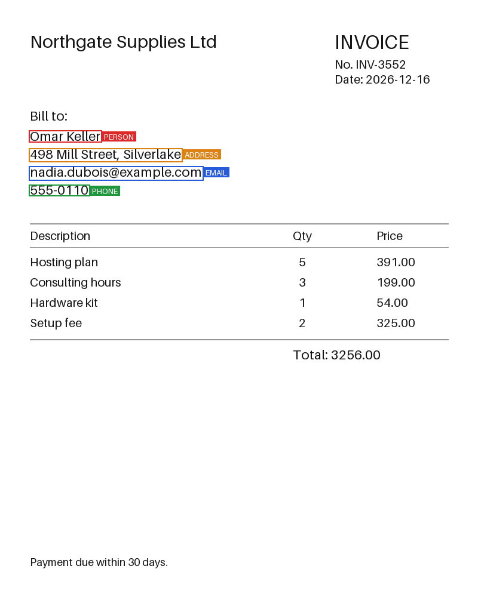
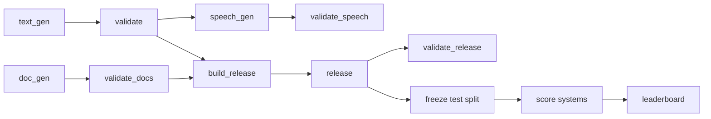
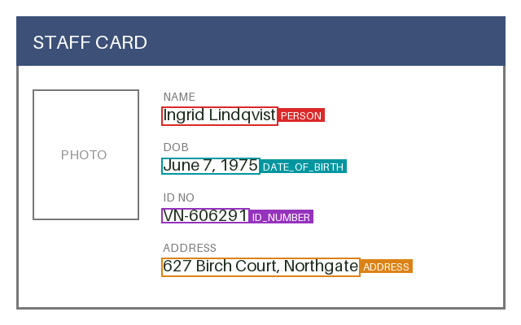

# PII Dataset Toolkit


[](https://huggingface.co/datasets/hussain-khalid/pii-dataset)

Reproducible tooling for building, validating and benchmarking **synthetic** datasets for
personal-data (PII) detection, in three modalities: text with labelled spans, document images
(invoices, forms, ID-style cards) with labelled bounding boxes, and speech audio with
millisecond-precision PII timestamps. All data is fabricated. No real person's information is
used anywhere.



## What this project demonstrates

- **Reproducible pipelines.** Seeded generators, byte-identical output for the same seed, and
  tests that check it.
- **Multimodal synthetic data.** Text with character-offset spans, document images with exact
  pixel bounding boxes, and speech audio with millisecond-precision PII timestamps — all from
  the same seeded text records.
- **Data quality.** Schema validation, exact and near-duplicate removal, split isolation,
  per-record provenance and a checksum manifest.
- **Evaluation.** A checksum-frozen test split, strict and relaxed scoring, bootstrap
  confidence intervals, label mappings to other label sets, baselines and a leaderboard.
- **Documentation.** A dataset card generated from the real numbers, documented findings and
  limitations, and CI that checks the pieces still fit together.

## Quick start

```bash
python3.12 -m venv .venv && source .venv/bin/activate
pip install -r requirements-dev.txt
make all          # generate, validate, build the release, benchmark, run the tests
```

`make all` writes the raw data to `data/raw/`, the release to `data/release/v0.2.0/`, the
preview images to `docs/images/previews/`, the frozen benchmark and leaderboard to
`benchmark/`, and a copy of the dataset card to `docs/DATASET_CARD.md`. The individual
commands for every stage are in [docs/pipeline.md](docs/pipeline.md).

## How it fits together



| Module | Purpose |
| --- | --- |
| `piikit.text_gen`, `piikit.doc_gen` | Seeded generators for text records and document images (supports `--locale`, `--hard`, `--noisy`, `--font`) |
| `piikit.speech_gen` | Converts text records to MP3 audio (Edge TTS) and aligns PII spans to millisecond timestamps (supports `--locale`) |
| `piikit.validate`, `piikit.validate_docs` | Validators for text and document datasets |
| `piikit.validate_speech` | Validates speech records: keys, audio file, span slices, time bounds |
| `piikit.dedup`, `piikit.splits` | Exact and near-duplicate removal; hash-based splits |
| `piikit.build_release`, `piikit.card` | Merge, provenance, manifest, generated dataset card |
| `piikit.validate_release` | Checks a finished release, including leakage between splits |
| `piikit.freeze`, `piikit.score` | Freeze the test split; score predictions against it |
| `piikit.baselines`, `piikit.leaderboard`, `piikit.label_map` | Baselines, ranking, label mappings |
| `piikit.systems.ocr_baseline` | Tesseract OCR baseline: word-level bounding boxes via pytesseract, regex rules, pixel-box output |
| `piikit.systems.ner_baseline` | Neural NER baseline: spaCy English transformer/sm model mapped to PII schema with regex fallback |
| `piikit.leaderboard_html` | Self-contained dark-themed HTML leaderboard generator with sortable tables and medal ranks |
| `piikit.submit` | One-command submission CLI: validates, scores, updates markdown and HTML leaderboards |
| `piikit.push_hub` | Converts a release into a Hugging Face `DatasetDict` and pushes to the HF Hub |
| `piikit.preview` | Draws labelled boxes on documents for visual checks |

## Data formats

**Text** (`text/*.jsonl`, one record per line). Offsets are Python string indices, end exclusive.

```json
{
  "id": "txt-000000",
  "text": "Contact: elena_fischer@example.net or call +1 555 0170.",
  "spans": [
    {"start": 9, "end": 34, "label": "EMAIL", "text": "elena_fischer@example.net"},
    {"start": 43, "end": 54, "label": "PHONE", "text": "+1 555 0170"}
  ],
  "source": "synthetic/text_gen",
  "generator_version": "0.2.0",
  "seed": 42,
  "template_id": "t07"
}
```

**Documents** (`docs/*.jsonl` plus `docs/images/*.png`). Boxes are `[x0, y0, x1, y1]` in
pixels with the origin at the top-left corner of the image.

```json
{
  "id": "doc-000001",
  "image": "images/doc-000001.png",
  "width": 640,
  "height": 400,
  "doc_type": "id_card",
  "fields": [{"label": "PERSON", "text": "Ingrid Lindqvist", "bbox": [200, 128, 342, 146]}],
  "source": "synthetic/doc_gen",
  "generator_version": "0.2.0",
  "seed": 42
}
```

Labels: `PERSON`, `EMAIL`, `PHONE`, `ADDRESS`, `ID_NUMBER`, `DATE_OF_BIRTH`.
Document types: `invoice`, `form`, `id_card`. Boxes come from the drawing call
(`ImageDraw.textbbox`), so they match the rendered text exactly.

**Speech** (`speech/*.jsonl` plus `speech/audio/*.mp3`). Derived from text records; `start_s`
and `end_s` are in seconds. `null` means the TTS tokeniser split the entity across word boundaries
(rare; typically hard-format values like `AB-123456` or obfuscated email addresses).

```json
{
  "id": "txt-000042",
  "audio": "audio/txt-000042.mp3",
  "duration_s": 3.87,
  "text": "Reference ZC-893329 was issued to Maya Meyer.",
  "spans": [
    {"start": 10, "end": 19, "label": "ID_NUMBER", "text": "ZC-893329", "start_s": 1.13, "end_s": 2.06},
    {"start": 34, "end": 44, "label": "PERSON",    "text": "Maya Meyer", "start_s": 3.60, "end_s": 4.63}
  ],
  "tts_voice": "en-GB-RyanNeural",
  "source": "synthetic/speech_gen",
  "generator_version": "0.2.0",
  "seed": 42,
  "template_id": "t12"
}
```



## Advanced Generator Options

The generators support multilingual synthesis, adversarial stress-testing, and scan degradation:

```bash
# Multilingual text & speech generation (German, French, Spanish)
python -m piikit.text_gen --n 1000 --locale de --out data/raw/text_de.jsonl
python -m piikit.speech_gen --text data/raw/text_de.jsonl --locale de --out-dir data/raw/speech_de

# Adversarial / hard format test split (unhyphenated IDs, inverted names, [at] emails)
python -m piikit.text_gen --n 500 --hard --out data/raw/text_hard.jsonl

# Documents with scan degradation (rotation, blur, JPEG compression) and custom font
python -m piikit.doc_gen --n 200 --noisy --font /path/to/font.ttf --out-dir data/raw/docs_noisy
```

## How the data stays fake

- Emails use the reserved `example.com`, `example.org` and `example.net` domains.
- Phone numbers use the 555-0100 to 555-0199 range reserved for fiction.
- ID numbers follow a made-up format (two letters and six digits).
- Names are random combinations from short word lists, and addresses use invented street and
  city names. A generated name can still match a real person by chance.

## Release

`piikit.build_release` merges the two datasets into one versioned release:

```
data/release/v0.2.0/
  text/{train,validation,test}.jsonl
  docs/{train,validation,test}.jsonl   docs/images/*.png
  DATASET_CARD.md      generated from the real counts
  PROVENANCE.json      inputs, checksums, parameters, licence
  MANIFEST.json        every file with SHA-256 and record count
  dedup_report.json    every removed record and why
```

1. **Deduplicates.** Text: exact duplicates (case and spacing ignored) and near-duplicates
   (Jaccard similarity of word 3-gram shingles at or above 0.8, found through an inverted
   index). Documents: repeated field sets and byte-identical images. The first occurrence wins.
2. **Splits** 80/10/10 from a hash of each record's id and the seed, so a record never changes
   split when other records are added or removed.
3. **Adds provenance** to every record: generator, input file and line, input checksum, a
   `synthetic: true` flag and the licence.
4. **Writes the manifest and the dataset card.** Nothing depends on the clock or machine.

`piikit.validate_release` re-checks a built release: manifest checksums and counts, the schema
of every split, provenance on every record, and no id, text or image shared between splits.
The generated card is in [docs/DATASET_CARD.md](docs/DATASET_CARD.md).

## Benchmark

A small benchmark built from the release's **test split**, with two tasks: text PII span
detection and document field detection.

- **Frozen.** `piikit.freeze` writes inputs (only `id` and `text`, or image details), gold
  labels and a `FROZEN.json` with the SHA-256 of every file. Scoring and baselines refuse to run
  if a frozen file changed, and re-freezing needs an explicit `--overwrite`.
- **Prediction format**, one line per benchmark id, every id required:

```json
{"id": "txt-000012", "spans":  [{"start": 9, "end": 34, "label": "EMAIL"}]}
{"id": "doc-000007", "fields": [{"label": "PERSON", "bbox": [200, 128, 342, 146]}]}
```

- **Metrics.** Micro-averaged precision, recall and F1 with one-to-one matching. Text
  *strict* needs the exact span and label; *relaxed* accepts the same label with character
  overlap of at least 0.5. Documents match boxes of the same label at IoU of at least 0.5. The
  95% interval on F1 is a bootstrap over test records (1,000 resamples, fixed seed). For text,
  the *false alarm rate* is the share of no-PII records that got at least one predicted span.

```bash
python -m piikit.score text --pred preds.jsonl --name my-system --save
python -m piikit.score text --pred preds.jsonl --name my-system --label-set presidio --save
python -m piikit.leaderboard --bench benchmark
```

Current results are in [benchmark/LEADERBOARD.md](benchmark/LEADERBOARD.md).

**Label mapping.** `--label-set presidio` or `conll` maps this dataset's labels onto another
label set before scoring. Labels with no equivalent are dropped from both the gold labels and
the predictions. The mappings are my own judgement and some are lossy; check them against the
current version of the target label set. Leaderboard rows with different label sets are not
directly comparable.

| This dataset | `presidio` | `conll` |
| --- | --- | --- |
| `PERSON` | `PERSON` | `PER` |
| `EMAIL` | `EMAIL_ADDRESS` | not mapped |
| `PHONE` | `PHONE_NUMBER` | not mapped |
| `ADDRESS` | `LOCATION` (lossy) | `LOC` (lossy) |
| `DATE_OF_BIRTH` | `DATE_TIME` (lossy) | not mapped |
| `ID_NUMBER` | not mapped | not mapped |

**Baselines.**
- `text-empty` and `docs-empty` predict nothing and establish the performance floor.
- `text-regex` is a rule-based system written with knowledge of the generator's common formats, serving as an optimistic reference for simple rules.
- `text-ner` is a neural baseline powered by spaCy's English NER (`en_core_web_trf` with fallback to `en_core_web_sm`), mapping spaCy entity types onto the dataset schema with regex fallback for high-precision formats (emails, phone numbers, IDs).
- `docs-ocr` runs Tesseract via `pytesseract`, applies regex rules to extracted word tokens, and maps matches back to pixel bounding boxes.

See [benchmark/LEADERBOARD.md](benchmark/LEADERBOARD.md) and the interactive [docs/leaderboard.html](docs/leaderboard.html).

### Submitting a system to the leaderboard

Use the one-command submission CLI to evaluate any prediction file against the frozen benchmark:

```bash
python -m piikit.submit --task text \
    --pred build/preds/my_system.jsonl \
    --name "My System" \
    --html
```

This verifies the benchmark integrity, scores predictions with strict and relaxed micro-F1 and 95% bootstrap confidence intervals, writes the result to `benchmark/results/`, and updates both `benchmark/LEADERBOARD.md` and `docs/leaderboard.html`.

### Publishing to Hugging Face Hub

Push a validated release to the Hugging Face Hub as a public dataset:

```bash
python -m piikit.push_hub --release data/release/v0.2.0 \
    --repo your-username/pii-dataset \
    --token $HF_TOKEN \
    --with-images
```

### Dataset Versioning with DVC

To track data releases with DVC:

```bash
dvc init
dvc add data/release/v0.2.0
git add data/release/v0.2.0.dvc .gitignore
git commit -m "Track dataset release v0.2.0 with DVC"
```

## Findings

**1. Deduplication exposed a weakness in my own generator.** The first version had only five
fixed sentences with no PII. In a 1,000-record sample, 213 records (21%) were exact duplicates
and the no-PII class had five distinct texts. I added parameterised no-PII templates and capped
that class at about 20% of records. With the current generator (seed 42, 1,000 records), 76
records are removed (59 exact, 17 near-duplicates) and the no-PII class has 131 distinct texts.

**2. My first benchmark was saturated.** The regex baseline scored F1 = 1.000 on every label,
so the benchmark could not rank anything. I changed the generator so that about 25% of values use
a less common format (`Keller, Anna`, `anna keller`, `name [at] example.com`, `555.0142`,
`AB 123456`, `12 Apr 1990`, `985 Birch Ct, Westbury`) and added no-PII records with lookalikes:
ordinary dates and organisation names such as `Northgate Supplies`. The same baseline now scores
strict F1 0.805 (95% CI 0.752 to 0.853), with precision 0.936, recall 0.707, and false alarms on
14.3% of the no-PII test records. A model that handles the format variants should beat the rules.

## Limitations

- Text comes from a limited set of templates, and names and streets come from short lists shared
  across all splits, so scores overstate performance on unseen names.
- The benchmark test split is small (97 text records, 15 documents). Intervals are wide, and the
  document task cannot rank systems finely.
- Documents in the standard release use clean backgrounds and axis-aligned boxes; realistic scan degradation (rotation, blur, JPEG compression) and custom fonts can be simulated via `--noisy` and `--font`.
- Labels are exact by construction, which real annotated data never is.
- Document PNG bytes can differ between Pillow versions, which changes the benchmark's
  `frozen_id` and the image checksums, but not the annotations or text metrics.
- This is a small pilot for pipeline and evaluation tooling. It is not suitable on its own for
  training or evaluating a production PII detector.

## Project files

- [docs/pipeline.md](docs/pipeline.md): stages, design decisions, reproducibility, extending
- [docs/DATASET_CARD.md](docs/DATASET_CARD.md): contents and limitations of the release
- [CHANGELOG.md](CHANGELOG.md)
- [LICENSE](LICENSE) for the code (MIT) and [DATA_LICENSE.md](DATA_LICENSE.md) for the data (CC0)
