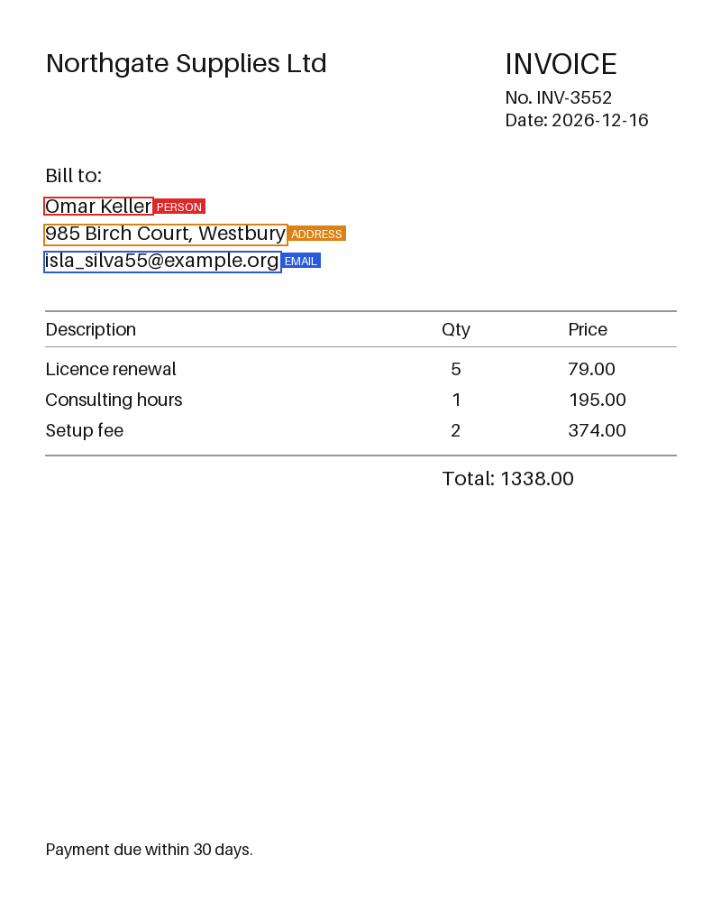
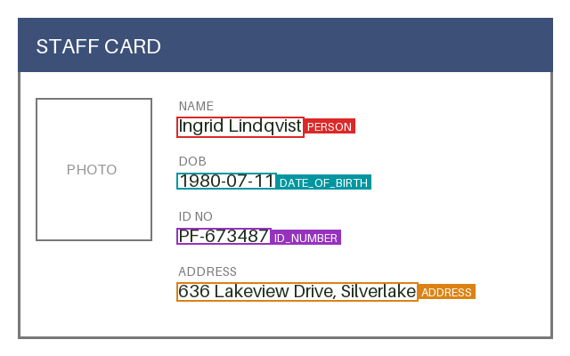

# PII Dataset Toolkit

A small, reproducible toolkit for building and validating **synthetic** datasets for
personal-data (PII) detection. All data is fabricated: no real people, no real contact
details.

> Work in progress. This README grows with each milestone.

## Status

| Milestone | Status |
| --- | --- |
| 1. Synthetic text with PII spans, schema, validator, tests | done |
| 2. Synthetic document images with bounding boxes, validator, previews | done |
| 3. Merge, deduplicate, provenance, splits, dataset card | done |
| 4. Benchmark: frozen split, scorer, baseline, leaderboard | planned |
| 5. Documentation and CI polish | planned |

## Quick start

```bash
python3.12 -m venv .venv && source .venv/bin/activate
pip install -r requirements-dev.txt   # Pillow for images, pytest for tests

# text dataset
python -m piikit.text_gen --n 1000 --seed 42 --out data/raw/text.jsonl
python -m piikit.validate data/raw/text.jsonl

# document-image dataset
python -m piikit.doc_gen --n 200 --seed 42 --out-dir data/raw/docs
python -m piikit.validate_docs data/raw/docs/docs.jsonl
python -m piikit.preview data/raw/docs/docs.jsonl --n 6 --out-dir docs/images/previews

# merged release: dedup, splits, provenance, dataset card
python -m piikit.build_release --text data/raw/text.jsonl --docs data/raw/docs/docs.jsonl \
    --out-dir data/release/v0.1.0 --seed 42 --version 0.1.0 --overwrite
python -m piikit.validate_release data/release/v0.1.0

pytest -v
```

## Text record format (JSONL, one record per line)

```json
{
  "id": "txt-000000",
  "text": "Contact: elena_fischer@example.net or call +1 555 0170.",
  "spans": [
    {"start": 9, "end": 34, "label": "EMAIL", "text": "elena_fischer@example.net"},
    {"start": 43, "end": 54, "label": "PHONE", "text": "+1 555 0170"}
  ],
  "source": "synthetic/text_gen",
  "generator_version": "0.1.0",
  "seed": 42,
  "template_id": "t07"
}
```

Offsets are Python string indices (`text[start:end]`), end exclusive. Labels: `PERSON`,
`EMAIL`, `PHONE`, `ADDRESS`, `ID_NUMBER`, `DATE_OF_BIRTH`.

## How the synthetic data stays fake

- Emails use the reserved `example.com`, `example.org` and `example.net` domains.
- Phone numbers use the 555-0100 to 555-0199 range reserved for fiction.
- ID numbers follow a made-up format (two letters and six digits).
- Names are random combinations from short word lists, and addresses use invented
  street and city names. A generated name can still match a real person by chance.

## Validation checks (current)

- Required keys and types are present.
- Every span satisfies `text[start:end] == span["text"]`, and offsets lie inside the text.
- Labels belong to the allowed set, and spans do not overlap.
- Record ids are unique, and the file is valid JSONL.
- Same seed produces a byte-identical file (checked by a test).

## Document record format (`docs.jsonl`, one record per line)

Images are PNG files under `images/`. Each record lists only the PII fields, each with a
pixel bounding box `[x0, y0, x1, y1]` (origin at the top-left corner of the image).

```json
{
  "id": "doc-000001",
  "image": "images/doc-000001.png",
  "width": 640,
  "height": 400,
  "doc_type": "id_card",
  "fields": [
    {"label": "PERSON", "text": "Ingrid Lindqvist", "bbox": [200, 128, 342, 146]}
  ],
  "source": "synthetic/doc_gen",
  "generator_version": "0.1.0",
  "seed": 42
}
```

Document types: `invoice`, `form`, `id_card`. Boxes come from the drawing call
(`ImageDraw.textbbox`), so they match the rendered text exactly. Fonts use Pillow's
bundled default font, so no font files need to be installed.




## Validation checks (documents)

- Required keys are present, `doc_type` and labels are in the allowed sets.
- The image file exists and its size matches `width` and `height`.
- Every box has four integer coordinates, positive area, and lies inside the image.
- Every box contains visible text (contrast check), so a box cannot point at blank paper.
- Boxes do not overlap each other, and ids are unique.
- The same seed produces identical annotations and identical image bytes (tested).

## Release (milestone 3)

`piikit.build_release` merges the two datasets into one versioned release:

```
data/release/v0.1.0/
  text/{train,validation,test}.jsonl
  docs/{train,validation,test}.jsonl   docs/images/*.png
  DATASET_CARD.md      generated from the real counts
  PROVENANCE.json      inputs, checksums, parameters, licence
  MANIFEST.json        every file with SHA-256 and record count
  dedup_report.json    every removed record and why
```

What it does:

1. **Deduplicates.** Text: exact duplicates (case and whitespace ignored) and near-duplicates
   (Jaccard similarity of word 3-gram shingles at or above 0.8, found through an inverted
   index so records are only compared when they share a shingle). Documents: repeated field
   sets and byte-identical images. The first occurrence always wins.
2. **Splits** into train, validation and test (80/10/10) from a hash of each record's id and
   the seed, so a record never changes split when other records are added or removed.
3. **Adds provenance** to every record: generator, input file and line, input checksum, a
   `synthetic: true` flag and the licence (`CC0-1.0`, set in `piikit/build_release.py`).
4. **Writes the manifest and the dataset card.** Nothing depends on the clock or machine, so
   the same inputs always give byte-identical output (tested).

`piikit.validate_release` re-checks a built release: manifest checksums and record counts,
the text and document schemas for every split, provenance on every record, and no id, text
or image shared between splits.

To publish the card on GitHub, copy it into the repo: `cp data/release/v0.1.0/DATASET_CARD.md docs/`.

### Finding: deduplication exposed a weakness in my own generator

The first version of the text generator had only five fixed sentences with no PII. In a
1,000-record sample, 213 records (21%) were exact duplicates, and the "no PII" class had just
five distinct texts. The dedup step surfaced this. I added parameterised no-PII templates
(order numbers, versions, amounts, times, products) that look a little like identifiers but
are not personal data, and capped the share of no-PII records at about 20%. With seed 42 and
1,000 records, 78 records are now removed (74 exact, 4 near-duplicates), and the no-PII class
has 128 distinct texts instead of 5.